# CalculatriceWS

Service web **SOAP** en Java exposant une calculatrice (somme, soustraction, multiplication, division), développé avec **Jakarta XML Web Services (JAX-WS)** et Maven.

> **TP2 : Mise en œuvre de Jakarta XML Web Services**

**Étudiant(e) :** *Ben Slim Malak*
 

## Objectifs

- Créer un service web SOAP en Java avec Jakarta XML Web Services (dépendances Maven)
- Découvrir la structure de données générée (WSDL / XSD)
- Annoter le code (`@WebService`, `@WebMethod`, `@WebParam`)
- Publier le service avec `Endpoint.publish`
- Tester les opérations avec SoapUI
## Technologies

| Outil | Version |
|---|---|
| JDK | 25 (17 ou 21 également compatibles) |
| Maven | via IntelliJ IDEA |
| `jakarta.xml.ws-api` | 4.0.1 |
| `jaxws-rt` | 4.0.2 |
| `jakarta.jws-api` | 3.0.0 |
| SoapUI | Open Source 5.x |

## Structure du projet

```
CalculatriceWS
├── pom.xml
└── src/main/java
    ├── service
    │   ├── ICalculatrice.java     # Interface du service (contrat)
    │   └── Calculatrice.java      # Implémentation métier
    └── serveur
        └── ServeurJWS.java        # Publication du service
```
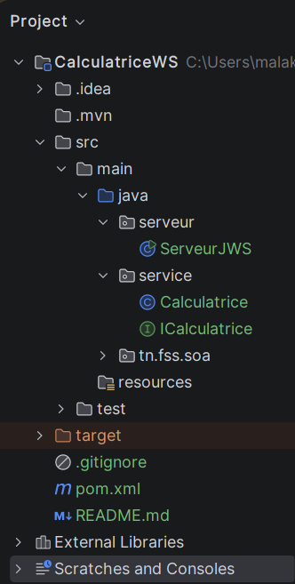

## Opérations exposées

| Opération | Paramètres | Retour | Remarque |
|---|---|---|---|
| `somme` | `a`, `b` (double) | `a + b` | |
| `soustraction` | `a`, `b` (double) | `a - b` | |
| `multiplication` | `a`, `b` (double) | `a * b` | |
| `division` | `a`, `b` (double) | `a / b` | SOAP Fault si `b = 0` |

## Lancer le projet


1. Ouvrir le projet dans IntelliJ IDEA, puis recharger Maven (*Maven → Reload project*).
2. Exécuter la classe `serveur.ServeurJWS` (clic droit → *Run*).
3. La console affiche :


   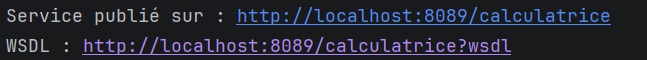

   
Le programme reste en cours d'exécution : c'est normal, le serveur tourne. Pour l'arrêter, utiliser le bouton ■ dans IntelliJ.

## Contrat du service

| Ressource | URL |
|---|---|
| Page d'information | `http://localhost:8089/calculatrice` |
| WSDL | `http://localhost:8089/calculatrice?wsdl` |
| XSD | `http://localhost:8089/calculatrice?xsd=1` |

Correspondance entre le code Java et le contrat :

| Java | WSDL / XSD |
|---|---|
| `@WebService` (interface) | `<portType name="ICalculatrice">` |
| `serviceName = "CalculatriceService"` | `<service name="CalculatriceService">` |
| `portName = "CalculatricePort"` | `<port name="CalculatricePort">` |
| `@WebMethod` | `<operation name="...">` |
| `@WebParam(name = "a")` | `<xs:element name="a" type="xs:double"/>` |
| Valeur de retour | `<xs:element name="return" type="xs:double"/>` dans `xxxResponse` |
| URL de `Endpoint.publish` | `<soap:address location="..."/>` |


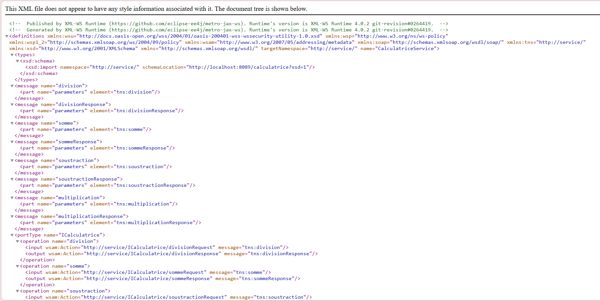
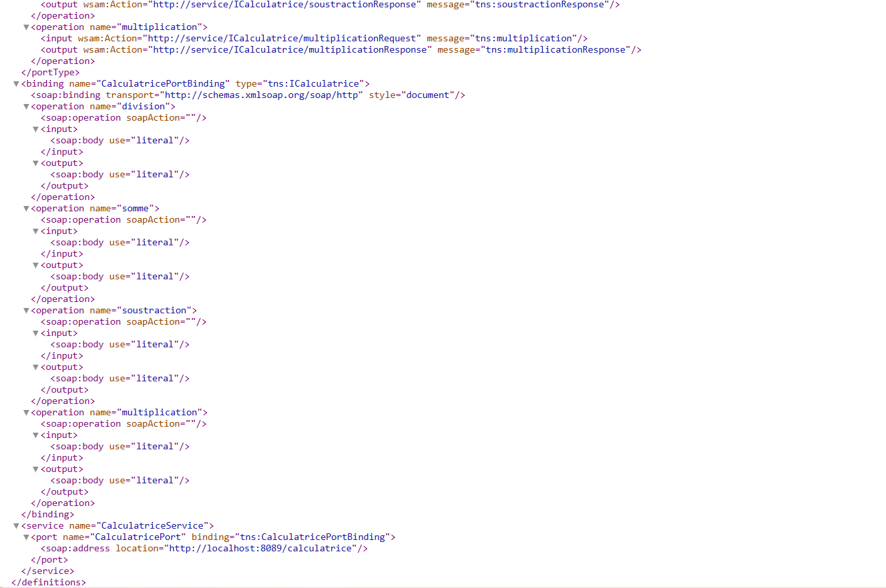
## Tester avec SoapUI

1. *File → New SOAP Project*
2. **Initial WSDL** : `http://localhost:8089/calculatrice?wsdl`
3. Ouvrir *CalculatricePortBinding → opération → Request 1*

Voici la structure:

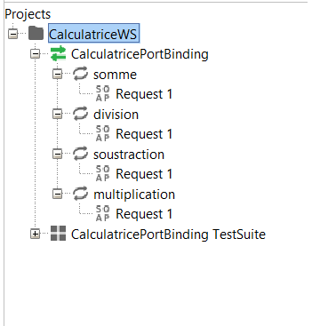

4. Remplacer les `?` par des valeurs, puis cliquer sur ▶
### Exemple : somme

Requête :

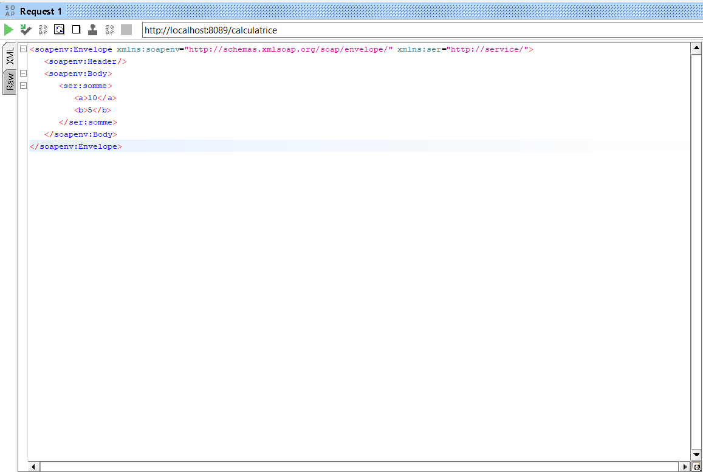


Réponse :

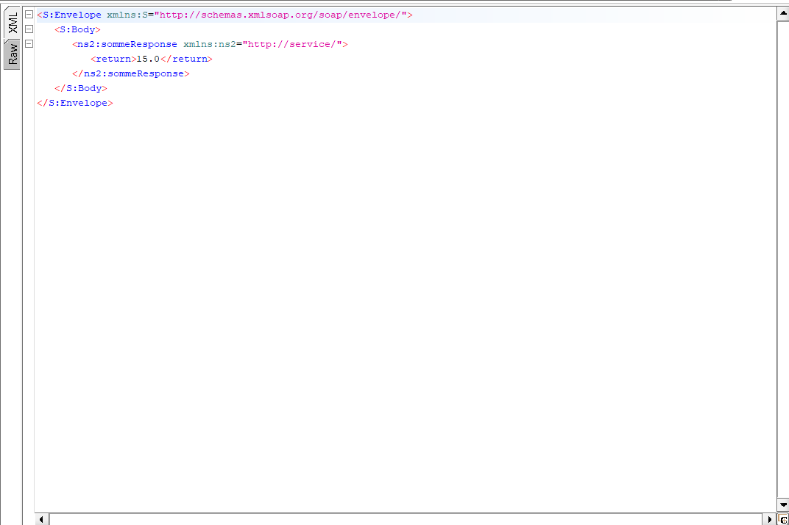

### Exemple : division-zero

Requête et réponse :

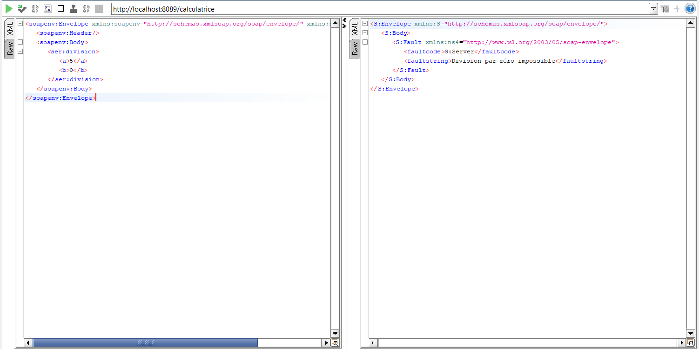

### Exemple : division

Requête et réponse :

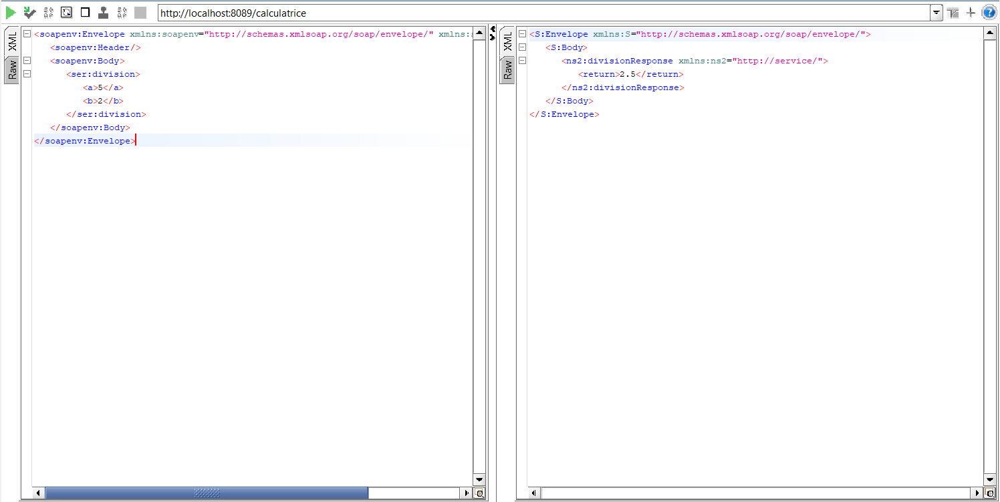

### Exemple : mutiplication

Requête et réponse :

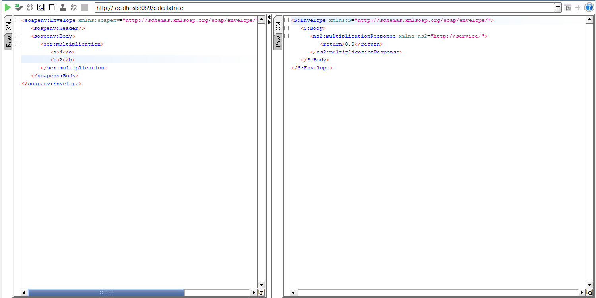

### Exemple : soustraction

Requête et réponse :

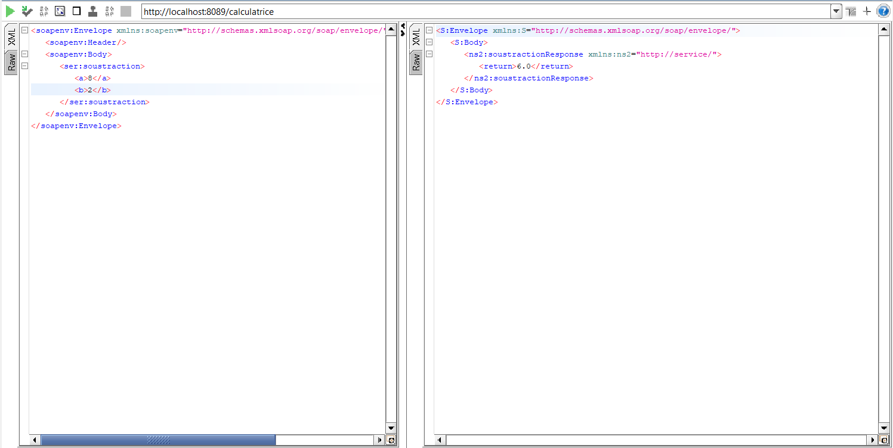


